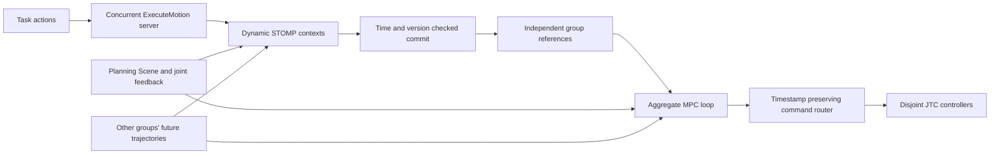

# Planning and execution architecture

## Ownership and task boundaries

`multi_arm_motion` contains no assembly sequence, docking command, mirror ID,
specific arm name or simulator reset logic. Robot descriptions, SRDF groups,
kinematics, joint limits, controller routes and scene topics are deployment data.
The consumer's task layer owns contact permissions and attach/detach transitions
in the authoritative Planning Scene.

The coordinator supports any number of disjoint groups of single DOF revolute
or prismatic joints. Continuous joints use unwrapped coordinates throughout
optimization, interpolation and controller commands. The configured numerical
coordinate guard is not a physical position limit. Floating and planar joints
are rejected rather than interpreted as independent scalar actuators.

## Concurrent runtime



`coordinator` exposes `multi_arm_motion_interfaces/action/ExecuteMotion` at
`execute_motion`. Each goal supplies a complete MoveIt MotionPlanRequest and an
optional total timeout. Velocity and acceleration scaling must be in `(0,1]`;
An optional relative-time `reference` starts at zero and contains exactly the
controlled group's joints. With `optimize_reference` it is resampled as a STOMP
seed and its temporal grid is chosen before peer forecasting. Otherwise it is
tracked without global geometric optimization, for task-generated Cartesian
contact paths. Both modes receive the same fresh-start, collision, constraint,
goal and velocity checks, MPC validation and stopping tails. No reference is an
unchecked controller passthrough.
planning time must be positive. An explicit start state must agree with feedback.
Measured arrival uses `execution.joint_tolerance` (default 0.01 rad/metres) and
`execution.stopped_velocity` (default 0.002 rad/metres per second). Start-state
agreement uses the independent `execution.start_tolerance` (default 0.005).
Bounded settling is reconciled into the first waypoint before the entire result
is revalidated. Planning goal tolerances constrain the nominal endpoint;
precision contact tasks must configure execution tolerance and verify their actual
contact pose before changing attachment state.

Joint ownership is reserved when a goal is accepted. Overlapping groups are
rejected; disjoint groups plan asynchronously and have independent results,
timeouts and cancellations. There is no goal pairing window or barrier requiring
an idle arm to acquire a task. A cooperative goal uses a group containing all
participating joints and consequently reserves those joints together.

Each group has its own planned absolute execution origin, based on its planning
budget. STOMP optimizes against peer references sampled at that origin. Global
collision and constraint revalidation runs outside the execution lock. At commit,
geometry, schedule and prediction revisions are compared; a changed revision
requires a fresh recheck, up to three attempts. After optimization,
`execution.commit_validation_budget` (default 2 s) reserves time for that sweep.
If validation misses the absolute origin, the origin can be deferred up to three
times; each deferral requires a complete sweep against fresh peer forecasts.
Relative waypoint timing is preserved. Repeated misses or invalidated results
fail explicitly. A planner failure affects only that goal.
The sweep checks the global planner's configured minimum clearance for optimized
paths and the MPC clearance for unoptimized contact references, in addition to
collision, joint bounds and task constraints.

The central MPC loop tracks all committed references together. It optimizes joint
velocities with tracking, velocity-change and obstacle-distance costs, projects
velocity and acceleration limits, and separately validates the predicted sweep.
Each cycle recentres its warm start on fresh feedback and reference tracking;
an exhausted optimization budget cannot indefinitely reuse an old velocity.
Candidate sweeps must satisfy task constraints before their objective can improve
on a feasible seed. Contact references hold their starting waypoint while waiting
for their scheduled origin.
The optional smooth task cost prefers the axis of cylindrical path regions and
penalizes excess mirror-normal tilt (`mpc.task_weight`, default 100000). It leaves translation
along the cylinder axis and rotation about the mirror normal free. This supplies
an optimization gradient before a hard path boundary is reached; the hard
constraint checks still determine acceptance.
Stationary reference components use a stronger terminal tracking weight
(`mpc.terminal_weight`, default 100000) only when the combined horizon endpoint
satisfies clearance and task constraints. This prevents residual soft repulsion
from keeping a valid endpoint permanently out of reach. Unsafe endpoints retain
ordinary tracking and must still pass every sweep and braking check.
Each candidate must also retain a valid stopping tail after the emitted prefix.
When a nominal candidate fails, an acceleration-bounded braking seed is checked
against the complete horizon and stopping tail. A valid local braking fallback
pauses active reference progress and is logged; it does not report the action
complete. If that alternative is unsafe, execution fails explicitly. The exact
tail checked by the solver is reused in the controller command.
Canceling a group removes its reference while other groups continue. Its joints
decelerate under the same limits. An execution safety failure latches the shared
executor stopped and reports failure to all affected goals.
An attachment or contact-permission update during a cycle triggers a fresh check
of the entire candidate horizon and braking tail. A safe transition can continue
within the original deadline. Invalid, repeatedly changing or late results stop
explicitly instead of being published against stale geometry.

`execution.seed_duration_scale` selects the optimized temporal grid before peer
forecasting; `execution.reference_duration_scale` slows a supplied contact
reference before commit. Both default to 1.3 and 1.0 respectively. Timing is not
changed after temporal collision validation. Commands contain an overlapping
prefix (`execution.command_steps`, default 2), followed by a checked stop under
the active acceleration limits. The router queues the original absolute stamp
and dispatches near it (`dispatch_lead`, default 0.005 s), because a standard JTC
replaces its current trajectory on receipt. Both controllers retain the same stamp.

For streamed trajectories, `execution.continuous_desired_commands=true` requires
JTC `interpolate_from_desired_state=true`. Each command starts at the previous
command's predicted desired state, preserving position and velocity continuity.
Measured minus desired tracking error remains in the predicted physical state
used by distance and task checks; it is not inserted as a discontinuity into the
next controller command. Published motion forecasts include that measured offset.
Actual measured error and stopped velocity still determine goal completion.
This short-horizon constant-offset estimate does not prove robust tracking under
arbitrary actuator faults; feedback expiry and tracking-limit failures remain
explicit stop conditions. The default false mode retains feedback-based starts
for controllers configured that way.

## Distance queries and constraints

The distance model includes ACM permissions, other arms, world objects and attached
payloads. Closest-point derivatives use a single FCL query followed by derivatives
of the nearest points' parent-link transforms. This supports aggregate groups;
it does not assume one serial chain.

Validation uses exact queries or a conservative motion bound. Every collision
shape is enclosed by a radius `R` about its parent link origin, including geometry
offsets, scaling, padding and attached bodies. Its displacement between two states
is bounded by `|translation_delta| + 2 R sin(rotation_delta/2)`. If the largest
robot point displacement is `D`, pair separation cannot decrease by more than
`2D` for previously unreported pairs. Reported nearby pairs additionally use
their relative parent-frame displacement bound; common rigid motion does not
invalidate their separation. SINGLE distance queries retain all nearby pairs,
and immutable shape spheres are cached across cycles. The cached lower bound is
used only when it still proves the requested clearance. Otherwise FCL is queried
and the anchor is replaced. This preserves
the sampling resolution while avoiding redundant mesh queries.

MoveIt path constraints are carried from each request into global commit, MPC
validation and the command's stopping sweep. The generic
`link_normal_horizontal nx ny nz tolerance` constraint is also understood there;
it uses the single orientation constraint's link name and leaves rotation about
the normal free. The imported planner's old constraint spelling remains accepted
for compatibility. Constraints are acceptance conditions, not an equality
constrained MPC optimizer: a narrow manifold can cause a safe rejection.

World geometry is immutable within a solve snapshot and refreshed each cycle.
Changed geometry/attachments during command validation require a fresh sweep of
the candidate and its stopping tail within the original computation deadline.
An unsafe result or missed deadline stops execution.
Unchanged full-scene messages and fixed-transform heartbeat timestamps do not:
the coordinator compares the actual geometry and transforms before invalidating.
The optional `planning_scene_service` synchronizes the authoritative scene before
each planning job, outside the execution lock. Snapshots retain its attachments
and geometry while overlaying the latest measured joint positions and velocities.
This avoids planning a contact phase against an ACM update that has not yet
arrived through the monitored-scene subscription. Commit failures identify the
violated bound, task constraint or collision pair and trajectory time.
Future robot motion is represented explicitly; moving world-object pose forecasts
and nonzero uncertainty tubes are not supported. They must not be presented as
guaranteed robust predictions.

## Time, controller commands and stopping

STOMP's dynamic time grid is preserved; a plan exceeding velocity limits is
rejected rather than retimed against different future obstacle states. Actual
execution is constrained by MPC acceleration and velocity limits. Curves have
continuous position and velocity; jerk is not bounded.

Each update has an absolute future start stamp. The prior controller polynomial
predicts that start state; fresh feedback corrects its position estimate. Both
controllers receive the same start stamp. The command router checks ownership,
dimensions, finite values, timestamps, replay, subscribers and a zero-velocity
stopping tail before publishing any split output.

Every short command includes a fully checked, acceleration bounded braking tail.
If a nominal candidate is unsafe, independent active groups are also tested with
one group's rows braking while peers keep their reference motion. The entire
mixed candidate and stopping tail must pass the same checks. Only the selected
groups' reference clocks pause; if no mixed candidate is safe, all groups brake.
`execution.command_steps` (default 2, at most the MPC horizon) selects the checked
prefix length. Updates overlap their prefixes so ordinary scheduling jitter
does not repeatedly enter the previous command's stopping segment. Braking uses
the active goals' scaled acceleration limits.
If the producer exits or misses an update, the last trajectory decelerates to
zero without requiring another process to send a stop command. A late MPC result
is rejected. Stale feedback retains that last checked command rather than
inventing a new trajectory from stale positions. If a new braking sweep cannot
be validated, the executor reports it and retains the previous tail.
An isolated command computation deadline miss also publishes nothing and
retains that tail. `execution.max_consecutive_deadline_misses` (default 3, zero
for immediate failure) bounds retries from fresh feedback. Reference clocks
pause for missed cycles; action wall-clock deadlines remain unchanged.
Consecutive misses beyond the limit latch execution stopped and fail the goals.

Services:

- `stop_motion`: latch stopped, terminate goals and request checked braking.
- `resume_motion`: require no active goals, fresh feedback and low measured
  velocity; clear old command history and resume.
- `reset_motion_predictions`: clear external forecast versions while stopped
  with no active goals, for an explicit environment or producer reset.

Execution is disabled by default. The deployment must exclusively own its
controllers. Controller interpolation/replacement, clock agreement, tracking
error and sensor/transport latency must be checked for each robot. This is a
ROS executor with deadline checks, not a certified hard realtime safety system.
Collision validation uses configured time/joint sampling; tracking and latency
require suitable deployment margins.

## Prediction contract and plugin compatibility

MotionPrediction contains source, increasing version, absolute start, validity,
joint names and timed samples. Malformed, duplicate, nonfinite, expired,
multiply-owned and out-of-bounds predictions are rejected. Coordinates must
remain consistently unwrapped. Cubic interpolation is used where both endpoints
specify velocities; other samples use linear interpolation. Holding the final
position is permitted only inside the stated validity interval.

The coordinator injects immutable long peer-reference forecasts directly through
the planner's TemporalContext extension. Its published aggregate MPC prediction
describes the validated short horizon. Predictions remain forecasts, not
reservations that guarantee another robot's tracking accuracy.
The published source defaults to the node's fully qualified name; configure
`mpc.prediction_source` and `mpc.prediction_topic` for other deployment layouts.
`dynamic_stomp.random_seed` selects reproducible rollout sampling in the coordinator
(`-1` leaves the random
generator unseeded by the planner). STOMP uses stochastic optimization rollouts;
it does not use an RRT search or an OMPL fallback.

MoveIt plugins remain available:

| Plugin | Interface |
| --- | --- |
| `dynamic_stomp/DynamicStompPlanner` | PlannerManager with temporal collision cost |
| `space_sim_stomp/StompPlanner` | Legacy ID, dynamic mode off by default |
| `multi_arm_hybrid_planning/StompGlobal` | Hybrid Planning GlobalPlannerInterface |
| `multi_arm_hybrid_planning/IndependentProgress` | TrajectoryOperatorInterface |
| `multi_arm_mpc/DistanceMpc` | LocalConstraintSolverInterface |

`hybrid.launch.py` starts the concurrent runtime by default. Setting
`legacy_runtime:=true` starts the upstream single-goal HybridPlanner manager and
the adapter plugins. The upstream trajectory interface does not carry the global
temporal origin through to execution; use the concurrent runtime for scheduling
and commit checks. No OMPL/RRT fallback is used by either global implementation.

## Deployment and validation

Launch the generic runtime with a ROS parameter YAML containing robot_description,
robot_description_semantic, group_name, joint limits and any kinematics:

```bash
ros2 launch multi_arm_hybrid_planning hybrid.launch.py robot_config:=/absolute/robot.yaml
```

Start `command_router` separately with controller names, joint lists and command
topics. A space_sim deployment launcher is supplied by the consumer at
`space_sim_moveit_config/launch/hybrid_motion.launch.py`; it is not part of this
generic repository. It connects to the existing MuJoCo controllers and monitored
scene and requires `enable_execution:=true` to move.

`examples/concurrent_smoke.py` verifies disjoint concurrent goals, measured overlap,
overlapping ownership rejection, independent cancellation, unreachable goals,
stop/resume and producer loss. It uses a cubic-interpolated software controller,
not a model of physical tracking. `examples/slider_smoke.py` exercises the upstream
plugin adapters. Run either in an unused ROS domain.

Unit tests cover prediction versions/validity, time interpolation and branch cuts,
ACM, attached geometry, closest-point gradients, conservative distance bounds,
future peer collisions, constraints, solver dimensions, acceleration limits and
braking. The consumer's `space_sim/test/test_hybrid_motion.py` records actual
MuJoCo joint overlap, errors and matching routed controller stamps.

WSL testing exposed intermittent Fast DDS discovery/request timeouts. The TCP/SHM
`LARGE_DATA` transport completed the concurrent software fault suite; UDP was also
used for articulated simulation. Startup discovery must be allowed to finish,
and controller spawners must not time out before robot-description discovery.
Transport background: [Fast DDS environment variables](https://fast-dds.docs.eprosima.com/en/2.14.x/fastdds/env_vars/env_vars.html).
# Reference tracking configuration

`mpc.tracking_weight` controls the reference tracking term (default 10). Its
scale must be considered alongside the distance costs and robot units. The
satellite integration uses 10000 to reduce deviations from the validated global
path; this tuning passed fresh complete assembly runs in three initial-face
orders, including return home. The consumer's validation record distinguishes
older sequence gates from the latest independently progressing sequences.

`execution.reference_lag_tolerance` defaults to zero (disabled). A positive
value enables independent progress adjustment: project the predicted physical
configuration onto the already reached portion and current nominal portion of
the unwrapped joint reference, then delay only a lagging group's reference.
Wall-clock action deadlines remain unchanged, and updated commands still require
collision validation against peer forecasts. This mode has passed software
smoke checks but has not been validated in physical assembly.

A reference cannot complete before its duration has elapsed, even when its first
and last configurations coincide. Completion also requires measured position
and stopped-velocity tolerances.
